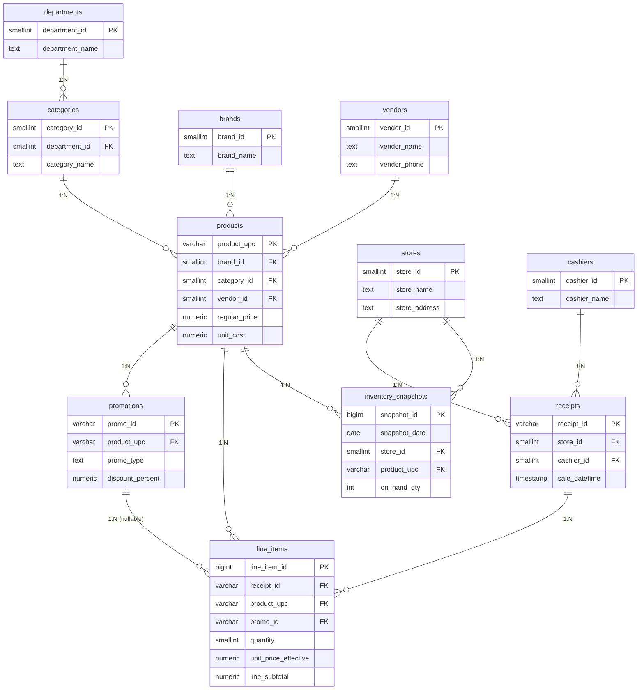

# 架构与设计说明（Architecture & Rationale）

## 1. 逆向工程得到的实体与关系

从四个扁平文件中识别出 **11 个实体**，分两类：

- **维度（dimensions）**：`departments`、`categories`、`brands`、`vendors`、`stores`、`cashiers`、`products`
- **事实（facts）**：`promotions`、`receipts`、`line_items`、`inventory_snapshots`

`products` 既是「商品」维度、又是把散落属性汇聚起来的中枢（hub）；`promotions` 是商品级的事实；`receipts` 是票头事实、`line_items` 是票行事实；`inventory_snapshots` 是周期性库存事实。

### ERD（权威版，Mermaid）



图片版（用于报告/演示）：见 [docs/erd.png](./erd.png)。

## 2. 规范化决策（每一步的「为什么」）

### 2.1 把重复描述性属性抽出为维度（消除冗余）

扁平销售表在**每一行**都重复 `store_name/address/city/state/zip`、`brand`、`department_name`、`category_name`、`size`、`unit`、`vendor_name/vendor_phone`、`pack_size`、`regular_price`、`unit_cost`。以 53,286 行计，这意味着约 **10 个冗余列 × 50k 行 ≈ 50 万次重复存储**。规范化后：

- 门店属性 → `stores`（3 行）
- 品牌 → `brands`（21 行）、部门 → `departments`（8 行）、类目 → `categories`（60 行）、供应商 → `vendors`（9 行）
- 商品描述属性 → `products`（60 行）

收益：存储量骤降；更新一处即可；引用完整性由外键强制（不可能再出现「同一 UPC 两个不同供应商」）。

### 2.2 部门 → 类目 → 商品的层级（3NF 传递依赖）

源数据里 `category_name` 与商品近似 1:1，但 `department_name` 是**由 category 决定**的（传递依赖 `product → category → department`）。若把 `department_name` 直接放在 `products` 上，当同一 category 换部门时会产生异常。因此拆为 `departments(8) → categories(60) → products(60)` 三层。这是严格 3NF 的体现，也天然支持「按部门汇总」的专用路径。

### 2.3 票头（receipts）与票行（line_items）分离

`store_id / cashier_name / tender_type / customer_segment / sale_datetime` 在同一 `receipt_id` 内恒定（探查验证每个字段 per-receipt 的 nunique 最大值均为 1）。若留在行级，既冗余又可能不一致。拆成：

- `receipts` —— 票头（13,259 行，每票一行）
- `line_items` —— 票行（53,286 行，PK `line_item_id`，`UNIQUE(receipt_id, line_number)`）

### 2.4 为什么把 `regular_price`/`unit_cost` 放在 `products`（而非独立价目表）

它们是**商品级基准价**、全年不变。放入 `products` 维度符合 3NF（由商品决定），且避免了每行重复。把「实际成交价」`unit_price_effective` 放在 `line_items`，因为它**由行级促销决定**（`line_subtotal = unit_price_effective × quantity`）。

> **权衡**：若未来需支持「历史变价」，应将 `regular_price`/`unit_cost` 提升为 `product_price_history`（慢变维/价目表）。挑战 01 数据全年度价格为常数，故按当前值建模并在文档中记录该边界。

### 2.5 丢弃的两类冗余列（3NF 去重 + 可推导）

| 被丢弃列 | 原因 |
|---|---|
| `sales.weekend_flag` | 与 `sale_datetime` 100% 一致，属**传递依赖**，可用 `EXTRACT(DOW FROM sale_datetime) IN (0,6)` 即时重算 |
| `inventory_snapshots.unit_cost / inventory_cost_value` | 探查显示逐位等于 `products.unit_cost` 与 `on_hand_qty × unit_cost`；保留会造成「同一成本两处存储、可能漂移矛盾」 |
| `promotions.product_name / department_name / brand`、销售表/库存表中的所有重复商品与门店属性 | 冗余副本，落入对应维度 |

## 3. 严格 3NF 与「分析效率」的刻意折中

1. **保留自然码作主键**（`store_id`、`product_upc`、`promo_id`、`receipt_id`）而非全用代理键 —— 它们在源数据中已证明唯一、稳定，且让事实表可直接跟原始 CSV 对账、重载幂等。代价是主键更宽；收益是可审计、可回灌。
2. **票头保留枚举文本**（`tender_type`、`customer_segment`）并加 `CHECK` 约束，而不是再拆两张低基数查找表 —— 2~3 个取值不值得额外 join，`CHECK` 已保证完整性。这减少了「过度拆分」。
3. **`line_items` 保存 `unit_price_effective` 与 `line_subtotal`**（可互相推导）—— 保留二者一是确保金额口径可对账（财务审计需要行级快照），二是避免每次都要重算 BOGO50 的取整规则。
4. **`inventory_snapshots` 不存成本**（见图 2.5）—— 若未来成本随时间变化，再引入慢变维；当前数据的简洁性 > 理论完备性。

## 4. 命名与约束约定

- 表名：复数名词（`products`、`receipts`）；列名 `snake_case`。
- 主键：`{实体名}_id` 或自然码（`product_upc`、`promo_id`、`receipt_id`）。
- 外键列名与被引用主键同名（`stores.store_id` ↔ `receipts.store_id`）。
- 约束：所有外键 `NOT NULL`（除 `line_items.promo_id` 允许 `NULL` 表示「无促销原价」）；`CHECK` 约束覆盖取值域（`promo_type`、`tender_type`、`customer_segment`）、数值域（`quantity>0`、`discount[0,100]`、价格非负）、日期域（`end_date ≥ start_date`）。
- 唯一约束：`categories(category_name, department_id)`、`line_items(receipt_id, line_number)`、`inventory_snapshots(snapshot_date, store_id, product_upc)`。

## 5. 面向分析查询的访问路径（索引）

`sql/indexes.sql` 针对挑战明确的分析问题建立索引：按（门店, 时间）聚合、按部门/类目钻取、按促销/会员过滤。核心索引：

- `receipts(store_id, sale_datetime)` 与 `receipts(sale_datetime)` —— 日销售趋势与预测
- `line_items(receipt_id)`、`line_items(product_upc)` —— 票行回表、商品聚合
- `line_items(promo_id)`（部分索引，NULL 除外）—— 促销 lift
- `products(category_id)`、`products(brand_id)` —— 部门/品牌钻取

## 6. ETL 数据流

```text
products_2024.csv ─┐
promotions_2024.csv ┤
inventory_snapshots_2024.csv ┤──► load_data.py ──► 清洗/类型强制
sales_2024_q1..q4.csv ─┘                              │   (4 种时间格式→TIMESTAMP)
                                                      ├─► 维度去重 + 代理键赋值
                                                      ├─► 引用完整性/CHECK 校验
                                                      ├─► 异常行捕获 → reports/etl/rejected_rows.csv
                                                      └─► 加载 → PostgreSQL (或 SQLite 回退)
                                                           日志: 各表 source_rows / loaded
```

运行方式见根目录 [README.md](../README.md)。

## 7. 与 Challenge 02（完整性 → 错误）的衔接

本阶段建立了「干净、可复现、可追踪」的底座。Challenge 02 将在**真实数据质量压力**下测试同一 schema，预计冲击点：

- 日期时间乱码/缺字段 → 本 ETL 的 `unparseable datetime` 拒绝路径已预留。
- 外键孤儿（UPC 漂移、promo_id 缺失）→ 本 ETL 的 orphan 校验会显式捕获。
- 数值越界（负 quantity、负价格）→ `CHECK` 约束已在 DDL 中兜底。
- 重复键（同一小票行号重复、快照键重复）→ `UNIQUE` 约束 + 去重策略已就位。

即：**规范模式与严格约束本身，就是数据质量的第一道防线。**